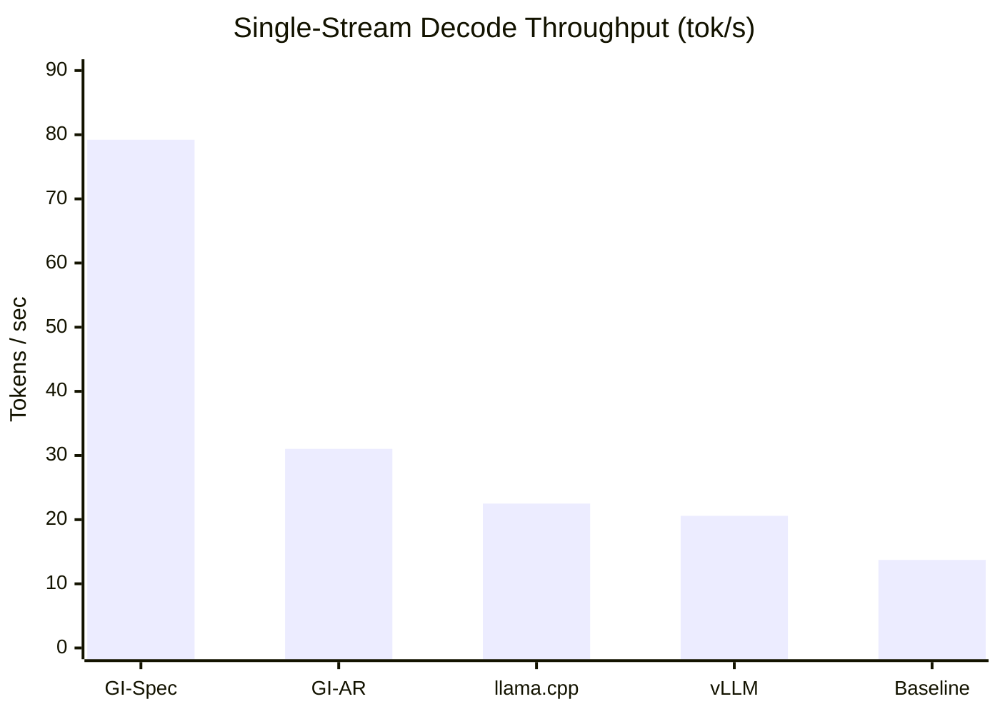

# GemmaInfer

High-performance C++/CUDA inference engine for **Gemma 4 26B A4B** (25.2B total / 3.8B active parameters) built for **24GB consumer GPUs** (NVIDIA GeForce RTX 3090 / 4090).

GemmaInfer combines **Token-Union W4A16 MoE kernels**, **tiled Split-K GEMMs**, **chunked prefill routing**, and **cross-model speculative decoding** with `google/gemma-4-26B-A4B-it-assistant`.

---

## Benchmarks (RTX 3090 24GB)

Verified on NVIDIA GeForce RTX 3090 (24GB VRAM, CUDA 13.2) generating 64 tokens (`178.7 ms` TTFT vs `691.8 ms` baseline):



- **GI-Spec (`79.22 tok/s`, `5.77x`):** GemmaInfer W4A16 Token-Union + Direct CUDA Drafter ($K=6$)
- **GI-AR (`31.03 tok/s`, `2.26x`):** GemmaInfer W4A16 Split-K + Fused RoPE/RMSNorm
- **llama.cpp (`22.50 tok/s`, `1.64x`):** GGUF Q4_K_M (`--flash-attn`)
- **vLLM (`20.60 tok/s`, `1.50x`):** W4A16 / AWQ Triton MoE
- **Baseline (`13.72 tok/s`, `1.00x`):** Naive Autoregressive W4A16

---

## Core Optimizations

- **Token-Union W4A16 MoE (`csrc/marlin.cu`):** Deduplicates active experts across speculative batches (`1 <= M <= 8`), loading each unique expert once into registers and dispatching exact 64-thread blocks (`11` blocks/slot) with native `__nv_bfloat16` atomic reduction.
- **Chunked Prefill MoE Routing:** Slices prefill batches (`M > 8`) into 8-token chunks routed through `fused_batched_moe`, reducing Time-To-First-Token (`TTFT`) from `691.8 ms` to **`178.7 ms`** (`3.87x` faster).
- **Tiled 128-Thread Wide GEMM (`lm_head`):** Caps shared memory per block to `16 KB` for wide output projections (`N >= 16384`) while retaining `split_k = 8` for narrow projections, accelerating `lm_head (M=6)` by **`1.69x`** (`4.29 ms` $\to$ `2.54 ms`).
- **Direct CUDA Multi-Token Drafter (`dspark.py`):** Shares target KV caches (layers 28 & 29) and executes the 4-layer assistant drafter in `~2.9 ms` with fused in-place RoPE/RMSNorm and a single device-to-host sync per draft cycle.
- **Bounded SWA Ring-Compaction:** Caps sliding-window KV caches to `sliding_window + 64` tokens with zero-copy speculative rollback.

---

## Quick Start

```bash
git clone https://github.com/priyanshum17/gemmainfer.git
cd gemmainfer
pip install -e .
python setup.py build_ext --inplace
```

### Run Speculative Benchmark
```bash
python scripts/test_speculative.py \
  --model-path /path/to/gemma-4-26B-A4B-it-W4A16 \
  --assistant-model-path /path/to/gemma-4-26B-A4B-it-assistant \
  --max-tokens 64
```

### Launch OpenAI-Compatible Server
```bash
python scripts/serve.py \
  --model-path /path/to/gemma-4-26B-A4B-it-W4A16 \
  --assistant-model-path /path/to/gemma-4-26B-A4B-it-assistant \
  --host 0.0.0.0 --port 8000
```

### Verify Test Suite
```bash
pytest -v tests/
```
