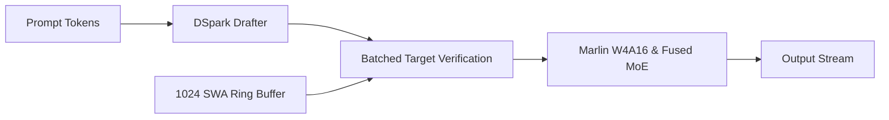

# GemmaInfer

A C++/CUDA inference engine for **Gemma 4 26B A4B** (25.23B total / 3.82B active parameters) optimized for **24GB consumer GPUs** (NVIDIA RTX 3090 / 4090).

GemmaInfer implements execution techniques from DeepSeek's DeepInfer: confidence-scheduled speculative verification (DSpark), sliding-window bounded KV cache management, and custom fused GPU kernels to bypass consumer memory bandwidth limits.

---

## Architecture



---

## Key Highlights

- **Gemma 4 26B A4B Native:** 30 layers (25 sliding window layers with 1,024 window + 5 full attention layers with 512 head dim and tied K/V), 128 fine-grained routed experts (top-8), and concurrent 2,112-dim shared dense MLP.
- **W4A16 Marlin Quantization (`csrc/marlin.cu`):** Coalesced 128-bit memory loads with on-the-fly register unpacking, compressing weights to 12.1 GB and leaving 11.9 GB of VRAM for KV cache.
- **DSpark Speculative Verification (`gemmainfer/speculative/dspark.py`):** Semi-autoregressive neural drafter with calibrated confidence head for dynamic draft length truncation, generating 1.8x-2.7x more tokens per memory read.
- **SWA Bounded Replay (`gemmainfer/core/block_manager.py`):** Circular ring-buffer memory recycling for 1,024-token SWA layers, reducing KV cache footprint by ~70%.
- **Fused CUDA Kernels (`csrc/`):** Custom kernels for per-head QK/V RMSNorm and in-place logit soft-capping across Gemma's 262,144 vocabulary.

---

## Memory Budget (24GB VRAM)

| Format | Weight Footprint | KV Cache Headroom | Status |
| :--- | :--- | :--- | :--- |
| **BF16 / FP16** | ~47.0 GB | 0 GB | Out of Memory |
| **FP8 (E4M3)** | ~23.5 GB | < 0.5 GB | Infeasible |
| **W4A16 (Marlin)** | **~12.1 GB** | **~11.9 GB** | **Fits with full context** |

---

## Quick Start

### Build
```bash
git clone https://github.com/priyanshumehta/gemmainfer.git
cd gemmainfer
pip install -e .
python setup.py build_ext --inplace
```

### Run Generation
```python
import torch
from gemmainfer.models.config import GemmaConfig
from gemmainfer.core.engine import GemmaInferEngine

config = GemmaConfig.gemma_4_26b_a4b()
config.quant_method = "w4a16"

engine = GemmaInferEngine(
    config=config,
    device="cuda",
    dtype=torch.bfloat16,
    enable_cuda_graphs=True,
    enable_dspark=True,
)

prompt = [1, 15, 230, 48, 92, 105, 300, 45, 99, 120]
output = engine.generate(prompt, max_tokens=64)
print("Output:", output)
```

---

## Verification & Benchmarks

```bash
# Run unit test suite
python tests/test_gemmainfer.py

# Memory footprint and DSpark throughput benchmark
python benchmarks/benchmark_marlin_gemma.py

# Latency profiling (TTFT and TPOT)
python benchmarks/benchmark_latency.py

# Micro-kernel memory safety and race-condition sanitizer (NVIDIA hosts)
compute-sanitizer --tool memcheck python tests/test_cuda_kernels_sanitizer.py
compute-sanitizer --tool racecheck python tests/test_cuda_kernels_sanitizer.py
```

---

## References

1. **DeepSeek DeepInfer & DSpark:** [deepseek-ai/DeepInfer](https://github.com/deepseek-ai/DeepInfer), *DSpark: Accelerating LLM Decoding via Confidence-Scheduled Speculative Verification*, DeepSeek-AI, 2026.
2. **Google DeepMind Gemma 4 26B A4B:** [google/gemma-4-26B-A4B](https://huggingface.co/google/gemma-4-26B-A4B) (30 layers, 1024 SWA, 128 routed experts, 2112 shared MLP).
3. **Marlin W4A16:** [IST-DASLab/marlin](https://github.com/IST-DASLab/marlin), *Marlin: Almost-lossless 4-bit Quantization for GPU-efficient LLM Inference*, Frantar et al., 2024 ([arXiv:2408.11743](https://arxiv.org/abs/2408.11743)).
4. **ExLlamaV2:** [turboderp/exllamav2](https://github.com/turboderp/exllamav2) (fast bit-tricks and zero-allocation execution loops).
5. **FlashInfer:** [flashinfer-ai/flashinfer](https://github.com/flashinfer-ai/flashinfer), *FlashInfer: Efficient Attention Engine for LLM Inference Serving*, Ye et al., 2024.
6. **DeepSeek DeepGEMM & FlashMLA:** [deepseek-ai/DeepGEMM](https://github.com/deepseek-ai/DeepGEMM), [deepseek-ai/FlashMLA](https://github.com/deepseek-ai/FlashMLA).

---

## License

Apache 2.0
